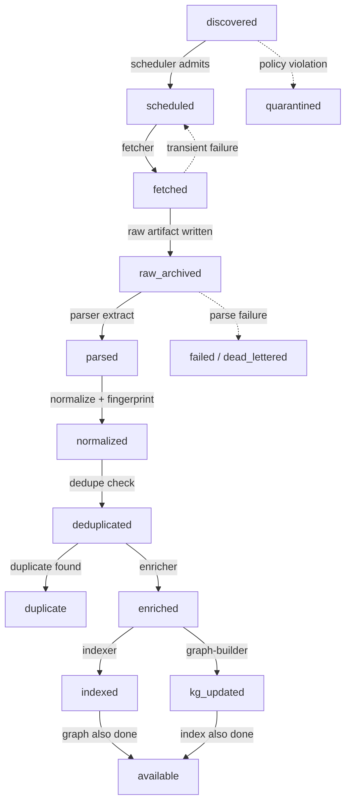

# Data Flow and Document Lifecycle

Status: Phase 0 baseline. This document is the contract for how a document moves through the
platform. Implementation must match it; deviations require an ADR.

## 1. End-to-end flow



`indexed` and `kg_updated` are sibling gates, not a sequence. Whichever completes second
promotes the document to `available`. Both write their own completion status; the join is
enforced by the `pipeline` library, not by ordering assumptions.

## 2. Transition contract

Every row below is one transaction: update `core.documents`, insert one
`core.document_events` row, commit, then publish. Column `attempt` is per-stage and starts
at 1.

| # | From → To | Owner | Guard (must hold before write) | Writes | Publishes |
|---|---|---|---|---|---|
| 1 | — → `discovered` | `scheduler` | `url_hash` not present in `core` for this tenant | `documents` row | — |
| 2 | `discovered` → `scheduled` | `scheduler` | robots allows; host under concurrency and rate limits | lease, `frontier` state | `doc.fetch.{lane}` |
| 3 | `scheduled` → `fetched` | `fetcher` | HTTP 2xx/3xx and content-type allowed | http metadata, `content_hash_raw` | — |
| 4 | `fetched` → `raw_archived` | `fetcher` | artifact exists in object store and SHA-256 matches | `raw_artifact_uri`, bytes | `doc.fetched` |
| 5 | `raw_archived` → `parsed` | `parser` | extraction produced non-empty text ≥ `min_text_chars` | `parsed_artifact_uri`, metadata | — |
| 6 | `parsed` → `normalized` | `parser` | deterministic normalizer version recorded | `document_text` row, `content_hash_norm` | — |
| 7 | `normalized` → `deduplicated` | `parser` | fingerprint computed; no canonical duplicate | `fingerprints` row | `doc.parsed` |
| 7b | `normalized` → `duplicate` | `parser` | canonical document found (exact hash or SimHash ≤ 3) | `duplicate_of` | — |
| 8 | `deduplicated` → `enriched` | `enricher` | summary/chunks/embeddings written; artifact referenced | `document_enrichment` | `doc.enriched` |
| 9 | `enriched` → `indexed` | `indexer` | all chunks upserted for this revision | `search.chunks` | `doc.indexed` |
| 9b | `enriched` → `kg_updated` | `graph-builder` | mentions and claims persisted for this revision | `graph.*` | `doc.graph_updated` |
| 10 | `indexed` or `kg_updated` (whichever is current) → `available` | second finisher | both gate statuses `done` | gate status | `doc.available` |
| F | any → `failed` | stage owner | error classified `permanent` (404, empty extraction) | `failed_stage`, error | — (event only) |
| F2 | any → `dead_lettered` | stage owner | retryable error, attempts exhausted | `failed_stage`, error | `doc.dead_letter` (replayable) |
| Q | any → `quarantined` | `fetcher` / `parser` | policy or safety rule triggered | quarantine reason | `doc.dead_letter` (audit only, never auto-replay) |

`304 Not Modified` is **not** a transition. The document stays `available`; `last_seen_at` and
`next_crawl_at` update, no artifact or revision is written, and no downstream stage runs.

**Refresh path.** A recrawl queues fetch work without changing `state`. If the response
differs, the fetcher creates revision N+1 and enters the lifecycle at `fetched` for that
revision. It does not replay `discovered`/`scheduled`: admission already happened, and the
previous revision remains live (`available_revision = N`) throughout.

### Required fields on every transition

| Field | Source | Rule |
|---|---|---|
| `document_id` | ULID at discovery | Never reused, never changes |
| `occurred_at` | DB `now()` at commit | Server clock only; never client-supplied |
| `attempt` | stage counter | Incremented before each retry; monotonic per stage |
| `processor_version` | build metadata | `service@semver+sha`; enables targeted reprocessing |
| `from_state` / `to_state` | state machine | Validated against the transition table |
| `trace_id` | W3C trace context | Propagated in Kafka headers and HTTP |
| `artifact_uri` | object store | Present when the transition produced or consumed an artifact |
| `error` | JSONB | `{class, code, message, retryable}`; null on success |

## 3. Identify, revision, and recrawl

- `document_id` identifies a **canonical URL** for a tenant. It is stable across content
  changes and recrawls.
- `revision` starts at 1 and increments only when `content_hash_norm` changes.
- `(document_id, revision)` is the **content version**. Every derived row in `search` and
  `core.document_text`, and every provenance-bearing row in `graph` (mentions, claims, edges),
  is keyed by it. Artifact paths include it where an artifact is revision-specific.
- A recrawl that finds unchanged content updates `last_seen_at` and `next_crawl_at` without
  creating a revision. No LLM or index work is repeated.
- A recrawl that finds changed content starts **revision N+1**: `current_revision` increments,
  `state` resets to `scheduled`, gate statuses reset, and `available_revision` stays at N.
  Search continues to serve revision N while N+1 is processed. On promotion,
  `available_revision = N+1` and revision N gets `superseded_by = N+1` in the same transaction.
- A document with `available_revision = null` is not searchable and is visible only to
  operators.
- Recrawl policy: adaptive by change rate (default 7 days for stable pages, 1 day for
  frequently changing, 30 days for archival), capped per host per day.
- URL identity: scheme + host lowercased, default port removed, fragment removed, tracking
  parameters removed, remaining query params sorted. `url_hash = SHA-256(canonical_url)`.
  Canonical URL may be overridden by `<link rel=canonical>` after parsing; if it changes the
  identity, the parser records a redirect alias rather than creating a second document.

## 4. Dedupe

1. Exact: `content_hash_norm` equality.
2. Near-duplicate: 64-bit SimHash, 4 × 16-bit band index; candidate if Hamming distance ≤ 3
   and length ratio within 20%.
3. Canonical selection: earliest `available` revision, then higher host authority
   (configured allowlist), then lowest `document_id` as deterministic tiebreak.
4. Duplicates remain in the corpus as `duplicate` with `duplicate_of` set. They are
   searchable only via the canonical document; citations to a duplicate resolve to the
   canonical id plus the alias.

## 5. Reprocessing

Triggered by `doc.reprocess` or by an operator tool. Modes:

| Mode | Starts at | Cost | Use when |
|---|---|---|---|
| `reparse` | `parser` (from raw artifact) | CPU only | extraction rules or normalizer changed |
| `reenrich` | `enricher` (from parsed artifact) | LLM | prompt/model changed |
| `reindex` | `indexer` (from enriched artifact) | embed + DB | chunker, embedding model, or schema changed |
| `regraph` | `graph-builder` (from enriched artifact) | DB + occasional LLM | resolution rules changed |
| `refetch` | `scheduler` | network | site changed or artifact corrupt |

Rules:

- Reprocessing never mutates a prior revision. It either creates a new revision (content
  changed) or writes new derived rows tagged with the new `processor_version` and
  supersedes the old ones.
- `superseded_by` / `valid_from_version` columns allow side-by-side comparison during a
  rollout. Default read path selects the highest `processor_version` that is marked active.
- Backfills are `bulk` lane and pause automatically when ingestion lag exceeds its SLO.

## 6. Provenance chain

Given any claim, citation, or search result, the system must reconstruct:

```
claim_id
  → graph.claims (document_id, revision, char_start, char_end, quote)
  → core.document_revisions (revision, content_hash_norm, raw_artifact_uri, http_status, fetched_at)
  → raw artifact (immutable bytes, SHA-256 verified)
  → document_events (every transition, processor_version, trace_id)
```

Invariants:

1. A claim whose quote does not match the referenced span of the referenced revision is a
   **data defect** and is excluded from retrieval until repaired.
2. No API response may cite a document without `document_id`, `revision`, and a span.
3. Report rendering includes the retrieval timestamp and artifact hash for each citation.
4. Deleting a document (legal takedown) tombstones it: content and artifacts are removed,
   `document_events` and a tombstone record remain, and all dependent claims are marked
   `retracted`. Provenance is never silently rewritten.

## 7. Worked example

```
t0         scheduler  discovered     doc=01J9Z6...  url=https://example.org/a
t0+2s      scheduler  scheduled      attempt=1 lane=bulk
t0+3s      fetcher    fetched        http=200 bytes=84210
t0+3s      fetcher    raw_archived   s3://raw/sha256/ab/cd/abcd...html trace=4bf9...
t0+4s      parser     parsed         words=1840 lang=en
t0+4s      parser     normalized     content_hash_norm=9f2c... parser=0.4.0
t0+4s      parser     deduplicated   simhash=0x91ab... neighbors=0
t0+9s      enricher   enriched       summary, 14 entities, 6 claims, 9 chunks
t0+10s     indexer    indexed        chunks=9 gate=done
t0+11s     graph-builder kg_updated  entities=14 claims=6 gate=done
t0+11s     indexer    available      (second finisher promotes; available_revision=1)
```

Every row above is a `core.document_events` record with a trace id. Replaying the topic from
any point must converge to the same `documents` projection; this is asserted by an
integration test that replays a captured transcript.

## 8. State machine invariants (enforced in code and DB)

1. No transition skips a stage, except terminal `failed`, `duplicate`, `quarantined`, and the
   refresh entry at `fetched` for revision N+1 (admission already happened).
2. A transition's guard is evaluated inside the same transaction as the write
   (`UPDATE ... WHERE state = expected AND current_revision = revision`); zero rows updated
   means the work is discarded as already handled.
3. State never moves backward for a revision. A new revision starts its own lifecycle and is
   the only reason `state` may reset.
4. The `available` transition requires `index_status = done` and `kg_status = done` for the
   current revision, and sets `available_revision` in the same transaction.
5. `attempt` never decreases for a stage; `attempt` resets to 1 only for a new revision.
6. Publishing happens only after commit. A publish failure is recoverable by `reconciler`
   and never leaves the DB claiming work that did not happen.
7. `document_events` is append-only and survives document deletion as a tombstoned record.
