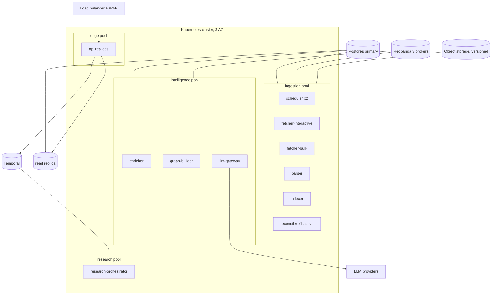

# Deployment Architecture

Status: Phase 0 baseline.

## 1. Environments

| Environment | Purpose | Topology | Data |
|---|---|---|---|
| `local` | Development, integration tests | Docker Compose, single node | Synthetic + opt-in crawl |
| `staging` | Pre-production, load/chaos tests | 1:1 services, reduced replicas, single-AZ | Scrubbed subset |
| `prod` | Live | Multi-AZ, managed Postgres, object store with versioning | Full corpus |

No environment shares credentials, buckets, or databases. Staging crawls a synthetic corpus
and a small allowlisted domain set; it must not crawl the open web at production rates.

## 2. Local topology (Docker Compose)

```
api              :8080
scheduler        :8081  (internal)
fetcher          :8082  (internal, + chromium sidecar)
parser           (no HTTP)
indexer          (no HTTP)
enricher         (no HTTP)
graph-builder    (no HTTP)
llm-gateway      :8083  (internal)
llm-stub         :8084  (deterministic fixtures, no network)
redpanda         :9092  (+ console :8090)
postgres         :5432  (pgvector)
s3 (silo)        :9000  (+ console :9001; see ADR-0011)
temporal         :7233  (+ ui :8233)
reconciler       (no HTTP)
```

Compose profiles: `core` (all runtime services and observability), `tools` (Redpanda
console, Temporal UI). The browser profile arrives with fetch/render logic. `make dev`
starts `core`; `make e2e` starts everything and runs the smoke check.

Every service also exposes a probe-only `/healthz`, `/readyz`, and `/metrics` listener. The
Phase 1 compose stack assigns these listeners ports 8080–8089; "no HTTP" above means no
business HTTP surface.

Resource limits in Compose are the same ratios as production requests, so a runaway service
fails locally too.

## 3. Production topology



Node pools are separated so that a CPU spike in parsing or a memory spike in headless
Chrome cannot evict the API or Temporal workers. Pool isolation is enforced with taints,
`ResourceQuota`, and `LimitRange`, not just node affinity.

## 4. Workload sizing (Phase 1)

| Deployment | Replicas (min–max) | CPU req/limit | Mem req/limit | HPA signal |
|---|---|---|---|---|
| `api` | 2–8 | 250m / 1 | 256Mi / 512Mi | RPS, p95 latency |
| `scheduler` | 2 | 250m / 500m | 256Mi / 512Mi | fixed |
| `fetcher-interactive` | 2–6 | 250m / 1 | 256Mi / 512Mi | lag |
| `fetcher-bulk` | 0–10 | 250m / 1 | 256Mi / 512Mi | lag, capped |
| `chromium` | 0–6 | 500m / 2 | 1Gi / 2Gi | pool utilization |
| `parser` | 1–8 | 500m / 2 | 1Gi / 2Gi | lag |
| `enricher` | 1–6 | 500m / 2 | 1Gi / 2Gi | lag, capped by token budget |
| `indexer` | 1–3 | 250m / 1 | 512Mi / 1Gi | lag |
| `graph-builder` | 1–3 | 250m / 1 | 512Mi / 1Gi | lag |
| `llm-gateway` | 2–6 | 250m / 1 | 512Mi / 1Gi | queue depth, 429 rate |
| `research-orchestrator` | 2–6 | 500m / 2 | 1Gi / 2Gi | Temporal task backlog |
| `reconciler` | 1 | 100m / 500m | 128Mi / 256Mi | fixed |

The sum of `fetcher-bulk` + `chromium` limits must fit inside a dedicated pool with headroom
for one node failure. Bulk workloads are the first thing scaled down during an incident.

## 5. Storage

| Store | Prod choice | Config |
|---|---|---|
| Postgres | Managed, Postgres 16, pgvector ≥ 0.7 | Multi-AZ, PITR 7 days, synchronous replica, 2 TB SSD, IOPS provisioned for write-heavy ingestion |
| Object storage | S3-compatible, versioning on, SSE-S3 | Lifecycle: raw → infrequent after 90 d → delete after 12 months; derived artifacts 12 months; DLQ payloads 30 d |
| Redpanda | 3 brokers, replication factor 3 | `min.insync.replicas=2`, 7-day retention, tiered storage optional, per-topic partition counts in `event-schema.md` |
| Temporal | Managed or self-hosted with Cassandra/Postgres persistence | Retention 30 days for closed workflows; archival optional |
| Backups | PG PITR + nightly logical dump to object storage; bucket versioning | Restore drill quarterly; RPO 15 min, RTO 4 h |

Object keys are content-addressed and immutable:

```
raw/{tenant}/{sha256[0:2]}/{sha256[2:4]}/{sha256}.html
parsed/{tenant}/{sha256_norm[0:2]}/{sha256_norm[2:4]}/{sha256_norm}.json.zst
enriched/{tenant}/{document_id}/{revision}/{processor_version}.json.zst
```

Bucket policy denies overwrite of an existing key; a re-upload with identical bytes is a
no-op. This is the guarantee behind immutable provenance.

## 6. Configuration and secrets

- Config is environment variables, validated at startup (fail fast, no silent defaults for
  required values). Precedence: defaults < file < env.
- Secrets live in a secret manager and are mounted as files, never baked into images or
  logged. `llm-gateway` is the only service with provider keys.
- Every service exposes `/healthz` (liveness) and `/readyz` (dependency check). Readiness
  fails if the DB is unreachable for > 2 s; liveness checks only the process.
- Feature flags gate stage behavior (`enable_claims_v2`, `render_fallback`), never data
  correctness. Flags are read at startup and on a 30 s poll; a flag flip must not require a
  deploy.

## 7. Release and migrations

- Images tagged `{service}:{semver}-{gitsha}`; `processor_version` is baked in and immutable.
- Deploy order for a pipeline change: consumer first (backward compatible), then producer.
  Never the reverse.
- Migrations: expand (add nullable column) → backfill in batches → switch readers → contract
  (drop) in a later release. No migration may lock a hot table for more than 1 s.
- Rollback = redeploy the previous image. Data rollback is forward-fix only; destructive
  migrations require a separate approved plan.
- The `core` state machine has a version in `pipeline` libraries; both languages must agree,
  enforced by a CI test that loads the same fixture in Go and Python.

## 8. Network and access

- Public ingress terminates at the load balancer; only `api` has an ingress rule.
- Cluster-internal calls use mTLS or a service mesh identity; default-deny network policy
  between namespaces.
- Egress is allowlisted: object storage, Postgres, broker, Temporal, LLM providers, and the
  configured crawl allowlist for egress-through-proxy (when enabled).
- The fetcher runs with no inbound network access and a read-only root filesystem.
- Database roles are per service (`api_ro`, `api_rw`, `pipeline_rw`, `search_rw`, etc.), with
  the grants described in `service-boundaries.md`.

## 9. Disaster recovery

| Scenario | Impact | Recovery |
|---|---|---|
| Postgres primary loss | Writes stop; reads serve from replica | Managed failover, ≤ 2 min; reconciler drains in-flight work |
| Broker loss (1 of 3) | No impact | Self-heal; `min.insync.replicas=2` |
| Broker total loss | Ingestion stops; reads continue | Recreate cluster; replay from `reconciler` sweep of non-terminal documents |
| Object store loss | No new documents; existing search works | Restore from versioned bucket; refetch documents whose raw artifacts are unrecoverable (mark `provenance_degraded`) |
| Temporal loss | Investigations in flight fail | Workflows are durable on recovery; otherwise users retry. Ingestion unaffected |
| Bad extractor deployed | Corrupt derived text | Roll back; `reparse` from raw artifacts; never refetch unless raw is missing |

## 10. Pre-launch production checklist

- [ ] PITR restore drilled successfully in staging.
- [ ] Broker outage scenario exercised with consumers running.
- [ ] `reconciler` proven to converge a transcript with 5% dropped publishes.
- [ ] Egress allowlist verified; fetcher cannot reach RFC1918 or metadata endpoints.
- [ ] Per-tenant rate limits enforced at the load balancer and `api`.
- [ ] Dashboards and alerts from `observability.md` deployed.
- [ ] Cost alerts at 50/80/100% of monthly LLM and storage budget.
