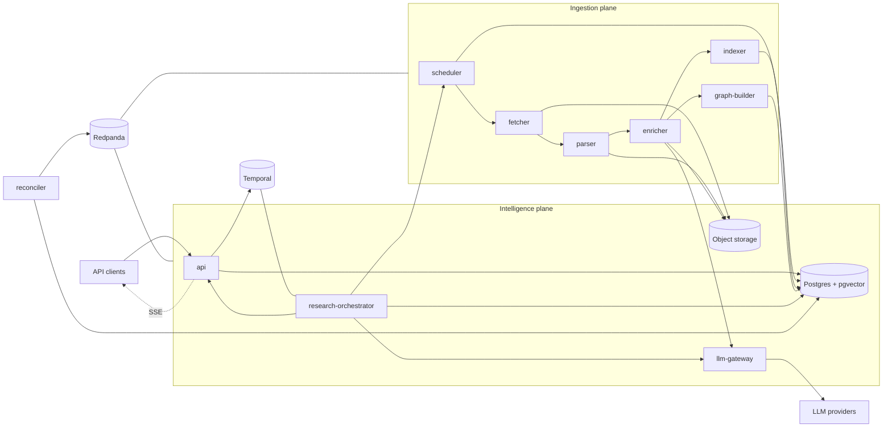

# System Overview

Status: Phase 0 baseline. Changes to this document require an ADR when they alter a boundary,
a data contract, or a workload isolation rule.

## 1. What the system does

A web research engine that:

1. Continuously ingests public web documents.
2. Converts them into a canonical, versioned, provenance-bearing corpus.
3. Extracts entities and claims into a knowledge graph.
4. Answers research questions through long-running, interactive investigations that
   retrieve evidence, follow citations, and produce cited reports.

The product promise is **every statement traceable to an archived artifact and a text span**.
That promise is the reason for most of the constraints in this document.

## 2. Workload classes

Three workloads with different failure semantics. They never share a worker pool, a queue,
or an autoscaling group.

| Workload | Characteristics | Priority | Isolation mechanism |
|---|---|---|---|
| Ingestion | High volume, continuous, latency-tolerant per document | High (never starved) | Dedicated topics, worker deployments, and DB connection pools |
| Intelligence processing | CPU/LLM intensive, asynchronous, cost-sensitive | Medium (can be delayed) | Separate topics and workers; LLM budget capped and separately metered |
| Research investigations | Interactive, long-running (seconds to 20 min), latency-visible | High (user is waiting) | Temporal task queue, dedicated workers, reserved LLM capacity, priority fetch lane |

### Isolation rules

1. A research investigation may **not** consume ingestion worker capacity. It calls the
   scheduler to enqueue a fetch in the `interactive` lane; ingestion does not change shape.
2. Ingestion may **not** consume research LLM capacity. `llm-gateway` enforces a hard
   reservation: 40% of the token budget for `interactive`, 60% for `batch`. Batch requests
   queue; interactive requests never queue behind batch.
3. Batch backfills (re-parse, re-embed, re-extract) use separate consumer groups and are
   throttled to a configurable fraction of capacity. They are the only workload allowed to
   be paused entirely.
4. Each plane has its own Kubernetes deployment, `ResourceQuota`, and DB connection pool.
   Saturation of one plane must be visible in metrics as that plane only.

## 3. System context

Note: `research-orchestrator` is a Temporal worker; it does not expose HTTP. `api` is the only
public entry point. `reconciler` is the only component allowed to republish work.

## 4. Service inventory

| Service | Language | Plane | Owns |
|---|---|---|---|
| `api` | Go | edge | Public REST + SSE, auth, rate limits, search queries |
| `scheduler` | Go | ingestion | Frontier, politeness, robots cache, priority lanes |
| `fetcher` | Go | ingestion | HTTP/Render fetch, robots enforcement, raw artifact write |
| `parser` | Python | ingestion | Extraction, normalization, fingerprinting, dedupe decision |
| `indexer` | Go | ingestion | Chunk + embedding index, index idempotency |
| `enricher` | Python | intelligence | Summaries, entities, claims, embeddings (LLM/CPU) |
| `graph-builder` | Python | intelligence | Entity resolution, claim persistence, graph edges |
| `llm-gateway` | Python | intelligence | Single LLM egress, routing, retries, cost accounting, caching |
| `research-orchestrator` | Python | research | Investigation workflows (Temporal), tool calls, budgets |
| `reconciler` | Go | ops | Detect stuck documents, republish, expire leases |

Infrastructure: Redpanda (log), PostgreSQL 16 + pgvector (state + search), S3-compatible
object storage (artifacts), Temporal (durable workflows).

## 5. Storage responsibilities

| Store | Holds | Does not hold |
|---|---|---|
| PostgreSQL `core` | Document state, lifecycle events, canonical text, metadata | Raw HTML, large artifacts |
| PostgreSQL `search` | Chunks, embeddings, lexical index | Source of truth for document text |
| PostgreSQL `graph` | Entities, claims, edges | Document bodies |
| PostgreSQL `research` | Investigations, messages, citations, progress events | Full retrieved page text (referenced) |
| Per-service schemas | `ingest` (frontier), `parse` (fingerprints), `fetch` (http cache), `ops` (leases), `api` (idempotency), `llm` (ledger, cache) | Anything another service reads directly |
| Object storage | Raw artifacts, parsed/normalized artifacts, extracted payloads | Anything queried by SQL |
| Redpanda | Work-in-flight events, replayable history (7 days) | Long-term state |

Postgres is the source of truth for lifecycle state. Redpanda is transport. Losing a topic's
retention window must never lose data; it only requires a reconcile sweep.

## 6. Consistency model

- **At-least-once** processing everywhere. Every handler is idempotent.
- **DB transaction first, publish second.** A stage commits its state change and lifecycle
  event, then publishes the next message. If publish fails, `reconciler` republishes after a
  lease timeout. No distributed transactions, no transactional outbox table.
- **Single writer per document revision.** A document is processed by at most one worker per
  stage at a time, enforced by `(document_id, stage)` advisory locks / state guards.
- Search index and graph are **eventually consistent** projections of `core`, with a stated
  freshness budget (see performance budgets). They can be rebuilt from artifacts without
  refetching the web.

## 7. Non-goals (Phase 1)

- Multi-tenant billing and quotas beyond a `tenant_id` column and per-key rate limits.
- Real-time crawling of private/authenticated content.
- Non-text media understanding (images, video, audio).
- A user-facing UI. `api` only.
- Horizontal sharding of Postgres. Single primary + read replicas is the Phase 1 envelope.

## 8. Capacity envelope (Phase 1)

| Dimension | Target |
|---|---|
| Crawl rate | 2 pages/s average, 10/s peak, 30/s burst (bulk backfill) |
| Pages crawled per day | 170,000 |
| Admitted to corpus per day | 50,000 during build-out, ~5,000 steady state (after dedupe, quality, and policy) |
| Corpus size (12 months) | 5,000,000 documents / 20,000,000 chunks / 40,000,000 claims |
| Concurrent investigations | 50 (peak 100) |
| Investigations per day | 1,000 |
| Search | 50 QPS, p95 200 ms |
| Investigation duration | p95 5 min, hard cap 20 min |
| API availability | 99.5% monthly |

The arithmetic behind these numbers is in `docs/engineering/performance-budgets.md`.

## 9. Document lifecycle

Canonical states:

`discovered → scheduled → fetched → raw_archived → parsed → normalized → deduplicated →
enriched → {indexed, kg_updated} → available`

`indexed` and `kg_updated` are sibling gates; they may complete in either order, and
`available` is set when both are done. `available_revision` identifies the revision that is
actually searchable while a newer revision is being processed.

Terminal off-ramps: `duplicate` (dedupe hit, aliases a canonical document), `failed`
(permanent, with `failed_stage`), `dead_lettered` (attempts exhausted, retained for replay),
`quarantined` (policy or safety violation, never processed further).

Details, transition owners, and idempotency keys: `docs/architecture/data-flow.md`.
Failure semantics: `docs/architecture/failure-handling.md`.

## 10. Exit criteria — Phase 0

- [x] Every service has a single owner and a stated responsibility (`service-boundaries.md`).
- [x] Core data contracts defined (`docs/data/*.md`): document, event, entity, claim, graph.
- [x] Architecture decisions recorded with rationale and revisit triggers (`docs/adr/`).
- [x] Every document has a lifecycle and provenance model (`data-flow.md`, `canonical-document-schema.md`).
- [x] End-to-end architecture diagram exists (this document, section 3; detail in `data-flow.md`).
