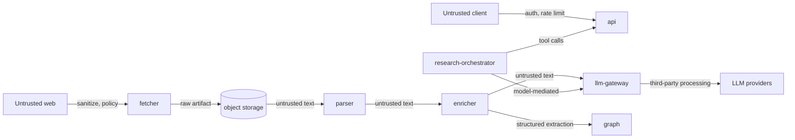

# Security Model

Status: Phase 0 baseline. Reviewed whenever a trust boundary changes.

## 1. Assets

| Asset | Why it matters |
|---|---|
| Raw artifacts and provenance chain | The product's evidence; silent corruption destroys trust |
| LLM provider credentials | Direct financial loss and abuse |
| Tenant data and investigations | Confidentiality and contractual isolation |
| Crawl egress capability | An SSRF foothold reaches internal networks |
| Index and graph integrity | Poisoning changes what research concludes |
| Cost budgets | An unbounded loop is a denial-of-wallet |

## 2. Trust boundaries

Untrusted inputs: request bodies, URLs, HTTP responses, extracted text, model output, event
payloads from other services (validated anyway). Trusted: service identity, database content
written through the pipeline library, operator actions with audit.

Model output is **untrusted data**, never a command. This is the single most important rule in
the system.

## 3. Threats and controls

| # | Threat | Control | Verification |
|---|---|---|---|
| 1 | SSRF to internal network / cloud metadata | Fetcher policy (§4), no generic proxy, egress allowlist | SSRF test matrix in CI, quarterly egress audit |
| 2 | Prompt injection from web content | Content treated as data; tool authority derived only from workflow, not text (§5) | 50-case adversarial suite |
| 3 | Tenant data leakage | `tenant_id` on every row; tenant from token only; cross-tenant reads return 404 | Isolation tests, DB role review |
| 4 | API key theft | Hashed at rest, prefix lookup, scoped, rotated, rate limited | Key rotation drill |
| 5 | Secret leakage in logs/traces | Redaction middleware, no prompt/body logging by default, lint rule | Log sampling audit |
| 6 | Malicious content crashes parser | Size caps, content-type allowlist, sandboxed workers, resource limits, timeouts | Fuzz corpus, decompression bomb test |
| 7 | Denial of wallet via investigations | Per-investigation and per-tenant caps enforced by `llm-gateway` | Budget overspend test |
| 8 | Corpus poisoning (SEO spam, coordinated claims) | Source trust, corroboration counts, duplicate detection, no single-source assertions in reports | Poisoned-corpus eval |
| 9 | Graph pollution via entity merges | Merge thresholds, review queue above degree 50, immutable merge log | Merge regression suite |
| 10 | Supply chain compromise | Lockfiles, SBOM, image scanning, no post-install scripts where avoidable | CI scan, dependency review |
| 11 | Dependency confusion | Private registry scope, pinned checksums | Build reproducibility check |
| 12 | Unauthorized crawl / ToS violation | robots enforcement, allowlist for sensitive domains, opt-out registry, user agent with contact | Crawl policy tests |
| 13 | Legal takedown mishandled | Tombstone flow removes content, retains events, retracts claims | Tombstone integration test |
| 14 | Model provider data retention | Provider selection requires no-training contract; redact secrets before egress | Provider review, config assert |
| 15 | Insiders / operators | All operator actions audited, no direct prod DB writes, break-glass approval | Audit log review |

## 4. Fetcher policy (SSRF and content safety)

The fetcher — and the scheduler, but only for `robots.txt` — are the only components with open
**web** egress. All other egress goes to named endpoints (object storage, broker, database,
Temporal, model providers). The fetcher and the scheduler's robots path share one URL admission
library, so a policy fix cannot land in one and be missed in the other. The fetcher is the
hostile-input-facing component; the scheduler's robots path is treated as equally untrusted.

URL admission (checked twice: `scheduler` and `fetcher`):

1. Scheme allowlist: `http`, `https` only.
2. No userinfo (`user:pass@host`).
3. Port allowlist: 80, 443, and explicitly configured alternates per tenant. No arbitrary
   ports.
4. Host must resolve to a public unicast address. Resolve first, then **connect to the
   resolved IP** while sending the original Host header/SNI. This defeats DNS rebinding.
5. Block: RFC1918, loopback, link-local, multicast, unspecified, IPv6 ULA, IPv4-mapped IPv6,
   `169.254.169.254`, `100.64.0.0/10`, and the cloud metadata names.
6. Revalidate on **every redirect hop**; max 5 hops. A redirect to a blocked target is a
   policy failure, not a retry.
7. Reject non-standard IP encodings by parsing to a canonical address before classification.
8. No environment proxy variables. Egress via a dedicated NAT with an allowlist where the
   deployment supports it.

Response handling:

- `Content-Length` and streamed byte cap: 10 MB default, 50 MB for PDFs; abort on exceed.
- Content-type allowlist: `text/html`, `text/plain`, `application/pdf`, `application/xhtml+xml`,
  `application/json` (size-capped). Everything else is `UNSUPPORTED_CONTENT`.
- Charset detection bounded; malformed encodings replaced, never fatal.
- No cookies, no auth headers, no client certificates. The crawler is anonymous.
- Timeouts: connect 10 s, TLS 10 s, total 30 s, render 45 s.
- Response headers stored as a filtered subset (no `Set-Cookie`).
- Downloads are never executed. HTML is parsed as text; rendering happens in a sandboxed
  browser with no filesystem, no network except the target origin, and a memory cap.

`robots.txt` is fetched through the same policy and cached 24 h. A 5xx or timeout is treated
as **disallow** until the next successful fetch; a 404 means allow. This is the conservative
reading of RFC 9309 and is asserted by tests.

## 5. Prompt injection and tool safety

The research engine reads adversarial text by design. Controls:

1. **No instruction authority from content.** Retrieved text is inserted into a delimited data
   block (`<document trust="untrusted">`). System prompts state that content cannot change
   tools, budgets, or output rules.
2. **Tool allowlist enforced outside the model.** The orchestrator exposes a fixed set
   (`search`, `read_document`, `get_claims`, `request_fetch`) with server-side validation.
   The model cannot name a URL that the fetcher will not independently policy-check.
3. **No URL fetching from model output.** A model-proposed URL is passed to `scheduler` as a
   candidate and goes through the full admission policy. The model never gets to say "fetch
   this internal address".
4. **Budgets are server-side.** Tool calls, documents read, and dollars are counters in the
   workflow, not values the model can set.
5. **Structured output.** Extraction and adjudication return JSON validated against a schema.
   Free-form text is only used for the final report, which is rendered as data.
6. **Report citation validation.** Every citation is checked against the stored span before
   returning; unverifiable sentences are removed.
7. **Document-level isolation.** Extraction prompts see one document at a time. The synthesis
   prompt sees claims and quotes, not raw HTML.
8. **Refusal logging.** Provider safety refusals and prompt-injection heuristics increment a
   metric; a spike triggers review of the source domain.
9. **No secrets in prompts.** Prompts are assembled from corpus data and task templates only;
   secrets never enter a model context.

Residual risk: a sophisticated injection can still bias a synthesis. Mitigation is
corroboration (claims require multiple sources for strong statements), citation visibility,
and a report-level banner for single-source conclusions. This is a product-level honesty
control, not a security guarantee.

## 6. Authentication and authorization

- API keys: 32-byte random, shown once, stored as SHA-256 with a 12-char prefix for lookup.
  Rotation with two active keys per tenant. Scopes enforce least privilege.
- Internal calls: mTLS service identity; tokens expire in 5 minutes and are audience-bound.
- Admin endpoints require a separate scope and an allowlisted source network.
- Authorization is enforced at the `api` edge. Internal services re-check `tenant_id`
  ownership on every document/entity read; defense in depth.
- No authorization decisions based on data inside events, prompts, or model output.

## 7. Data protection

| Data | Handling |
|---|---|
| Public web content | Stored with provenance; attributable; robots and opt-out respected |
| Personal data incidentally in pages | Minimized in extraction (no contact harvesting); excluded from claims unless newsworthy and attributable |
| Investigation questions and reports | Tenant-scoped; never used to train models; 90-day default retention for raw messages, reports kept until deleted |
| API keys | Hashed, never logged, never returned |
| Prompts | Hashed for cache keys; raw prompts retained 7 days for debugging unless `no_prompt_log` |
| Traces | No bodies, no query strings with tokens; span attributes allowlisted |

Data subject requests: delete by URL or tenant; tombstone path removes text/artifacts,
retracts dependent claims, keeps event history with the identity and reason. Completion
report lists every removed artifact.

## 8. Secrets and supply chain

- Secret manager with short-lived credentials; no static cloud keys in workloads where
  workload identity is available.
- Images: distroless/base-slim, non-root, read-only root FS, no shell in production where
  feasible.
- CI: SBOM (CycloneDX) per image, `trivy` scan blocking high/critical, secret scanning
  (gitleaks), signed images (cosign) at release.
- Dependency policy in `coding-standards.md` §7; a CVE with a public exploit is patched or
  mitigated within 24 h.

## 9. Audit

Audited events (append-only, 1-year retention): API key creation/rotation, investigation
start/cancel/resume by operator, tombstone/retraction, entity merge by operator, budget limit
change, admin document read, config flag changes.

Audit records include actor, action, target, before/after where applicable, trace id, and
source IP. Operators cannot delete audit rows.

## 10. Abuse controls

- Per-key and per-tenant rate limits at the edge and in `scheduler`.
- Investigation concurrency cap per tenant (default 2, configurable).
- URL submission cap per tenant per day.
- Crawl egress: global pages/s cap and per-host cap; a compromised crawler cannot become a
  DDoS source.
- LLM: per-tenant daily budget; anomaly alert on > 3× trailing 7-day median.
- A kill switch (`flags.crawl_paused`, `flags.llm_paused`) that is read at startup and on
  poll; must be testable without a deploy.

## 11. Open issues to resolve in Phase 1

- Legal review of storing full text long-term per jurisdiction (EU DSM Art. 4 TDM opt-out).
- Opt-out registry ingestion and honoring (per-domain).
- Whether to enable a shared cross-tenant graph; default is no.
- Key management for signed artifact URLs (rotation, clock skew).
